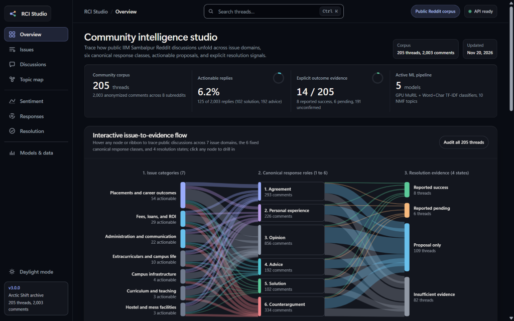

# Reddit Community Intelligence (RCI)

Interactive multilingual research studio analyzing anonymized public Reddit discussions around **IIM Sambalpur** and Indian MBA/CAT communities across **5 supervised NLP tasks**, **unsupervised NMF topic discovery**, **6 canonical community response roles**, and **explicit resolution-evidence tracking**.

- **Live Web Studio (Vercel):** https://rci-ten.vercel.app/app/
- **Corpus Version:** `v3.0.0` (`iim-sambalpur-arctic-shift-v3`) — **205 anonymized threads**, **2,003 human comments** across **8 active subreddits** (`r/IIMSambalpurUG`, `r/MBAIndia`, `r/IIMCATPreparation`, `r/CATPrep`, `r/iim_CAT`, `r/CATStudyRoom`, `r/CATpreparation`, `r/Indian_Academia`).



---

## Key Capabilities

1. **Anonymized Public Reddit Collection (`Arctic Shift` + Static Export Intake)**
   - Rate-limit-aware keyless ingestion via [run_arctic_shift_pilot.py](backend/run_arctic_shift_pilot.py) and static archive validation via [import_reddit_export.py](backend/import_reddit_export.py).
   - Author usernames stripped, inline emails/phones/`u/` mentions redacted, and AutoModerator sticky comments & GIF-only embeds filtered deterministically (`141` AutoMod + `7` GIF removed in `v3.0.0`).
2. **Upgraded v3 Multilingual NLP Stack (`MuRIL-DAPT v3` + `Word+Char TF-IDF` Hybrid + `NMF v3`)**
   - **Unsupervised Domain-Adaptive Pretraining (DAPT / MLM):** Continued masked language modeling of `google/muril-base-cased` strictly on `1,872` unique unlabeled anonymized Reddit texts (**perplexity reduced `31.97 → 14.50`** in 4 epochs without fabricating any labels).
   - **Sequence Architecture ([muril_classifier.py](ml/models/transformer/muril_classifier.py)):** Attention-masked `[CLS] + Mean + Max` pooling, LayerNorm, 5-branch Multi-Sample Dropout, Layer-wise Learning Rate Decay (`LLRD = 0.90`), single-label label smoothing (`0.05`), and validation-only scalar temperature scaling.
   - **Validation-Calibrated Hybrid Blending ([build_live_corpus_artifacts.py](backend/build_live_corpus_artifacts.py)):** Blends `MuRIL-DAPT v3` and `V2 Word+Char Calibrated TF-IDF` with blend weight `alpha` and multi-label thresholds calibrated strictly on held-out validation splits.
   - **Real Unsupervised Topic Discovery:** 10-cluster NMF (`3,272` unigram/bigram vocabulary terms) fit directly on the 2,003 human comments.
3. **Research Integrity & Epistemic Boundaries**
   - **Exact 6 Canonical Response Classes (fixed order):** `agreement`, `personal_experience`, `opinion`, `advice`, `solution`, `counterargument`.
   - **Proposal vs. Resolution Separation:** Predicted `advice`/`solution` comments are tracked separately from explicit first-person follow-up resolution signals (`reported_success`, `reported_pending`, `proposed_only`, `insufficient_evidence`).
   - **Zero-Leakage Benchmarks:** All splits are strictly grouped by `post_id` (`check_leakage()`), and multi-register training expansions pass automated exact-, 5-gram-, and 6-gram anti-contamination checks against the untouched 54 unseen 8-category robustness probes.
   - **Preserved Synthetic Archive:** `data/demo_synthetic/` and `ml/artifacts/demo_synthetic_v2/` remain untouched and selectable via `RCI_DATA_MODE=synthetic`.

---

## Model Generalization Summary (54 Unseen 8-Category Probes)

Benchmarked on the untouched 54-probe unseen stress test covering unseen templates, paraphrases, spelling errors, informal Reddit slang, short replies, ambiguous responses, parent-post context, and Hinglish code-mixing (`0` exact / 5-gram / 6-gram probe overlap):

| Task | Model (`v3_dapt_gpu`) | Held-out Test Macro F1 | 54-Probe Unseen Macro F1 (`v2` → `v3`) |
|---|---|---:|---:|
| **Issue** *(8-label, + parent title)* | `muril_dapt_v3_plus_title_hybrid` (`α = 0.75`) | `0.8924` | `0.9096` → **`0.9102`** |
| **Solution** *(binary actionable)* | `muril_dapt_v3_pooled` (`α = 1.00`) | `1.0000` | `0.7391` → **`0.8561`** |
| **Sentiment** *(3-class polarity)* | `muril_dapt_v3_tfidf_hybrid` (`α = 0.65`) | `1.0000` | `0.6139` → **`0.6758`** |
| **Response** *(6 canonical classes)* | `muril_dapt_v3_tfidf_hybrid` (`α = 0.30`) | `1.0000` | `0.5928` → **`0.6429`** |
| **Emotion** *(6-label multi-label)* | `muril_dapt_v3_pooled` (`α = 1.00`) | `1.0000` | `0.4126` → **`0.4925`** |

> *Note:* Real-corpus classifications displayed in the studio are model-inferred outputs while human gold annotation proceeds via the local Annotation Studio.

---

## Quickstart

### 1. Run with Docker Compose (Recommended — FastAPI + PostgreSQL 16)

```bash
docker compose up -d --build
docker compose exec web alembic upgrade head
```

Open **http://localhost:8000/app/** (API docs at `http://localhost:8000/docs`, health at `http://localhost:8000/health`).

### 2. Run Locally (Python 3.14)

```bash
python -m venv backend/.venv
# Windows: .\backend\.venv\Scripts\activate  |  macOS/Linux: source backend/.venv/bin/activate
pip install -r backend/requirements.txt

cd backend
uvicorn app.main:app --host 127.0.0.1 --port 8000
```

### 3. Local Human Annotation Studio (`/annotate`)

Launch the local-only human review UI (with keyboard shortcuts, explicit `uncertain` / `abstain` handling, and atomic CSV saves):

```bash
python backend/run_annotation_studio.py --host 127.0.0.1 --port 8765
```

### 4. Run the Full Offline Test Suite

```bash
pytest backend/ --ignore=backend/test_migrations_postgres.py -q
```

---

## Repository Layout

```text
api/                        # Slim Vercel serverless FastAPI entrypoint (api/index.py)
backend/
  app/
    api/demo.py             # Read-only Studio API (/api/demo/*)
    models/ & schemas/      # SQLAlchemy ORM + Pydantic contracts
    services/ingestion/     # Arctic Shift, Reddit OAuth, Static Export, Decodo providers
    services/nlp/           # Preprocessing, language/script detection, NMF, classical NLP
    static/                 # Dusk Studio interactive frontend (zero external JS build step)
  alembic/                  # PostgreSQL migrations
  annotation_studio_ui/     # Local human annotation workbench UI
  tests/                    # 2,180+ unit, contract, integrity, and PII isolation tests
  build_live_corpus_artifacts.py  # End-to-end DAPT MLM + v3 hybrid pipeline
data/
  live_corpus/              # Sanitized public Reddit corpus (corpus.json)
  demo_synthetic/           # Preserved isolated synthetic archive (opt-in)
ml/
  artifacts/live_corpus/    # Precomputed v3 predictions, NMF topics, & evaluation report
  models/transformer/       # MuRIL v3 pooled classifier + DAPT MLM trainer
docs/                       # Pilot guide, annotation guidelines, integrity & robustness reports
```

---

## Key Documentation

- [Real-Data Pilot Guide](docs/REAL_DATA_PILOT_GUIDE.md)
- [Human Annotation Guidelines](docs/ANNOTATION_GUIDELINES.md)
- [Robustness Benchmark Report](docs/ROBUSTNESS_BENCHMARK_REPORT.md)
- [Model Upgrade & Real Ingestion Notes](docs/MODEL_UPGRADE_AND_REAL_INGESTION.md)
- [ML Integrity Audit](docs/ML_INTEGRITY_AUDIT.md)
- [Local Demo Runbook](docs/LOCAL_DEMO_RUNBOOK.md)

## License

MIT — see [LICENSE](LICENSE).
