# Reddit Community Intelligence (RCI)

[](https://github.com/Sohham01/AI_Project/actions/workflows/ci.yml)


**Multilingual research studio for anonymized public Reddit discussions** around **IIM Sambalpur** and Indian MBA/CAT communities. Combines unsupervised domain-adaptive pretraining (**MuRIL-DAPT v3**), validation-calibrated **Word+Char TF-IDF** hybrids, **10-cluster NMF topic discovery**, **6 canonical community response roles**, and **explicit resolution-evidence tracking** — served via a zero-build FastAPI studio on both **Vercel** and **Docker Compose**.

[Live Studio (Vercel)](https://rci-ten.vercel.app/app/) · [System Architecture](#system-architecture) · [ML Pipeline](#multilingual-nlp-pipeline) · [Benchmarks](#generalization-benchmarks) · [Deployment & Security](#deployment--security) · [Quickstart](#quickstart)


---

## At a Glance

| Dimension | Current Production State (`v3.0.0`) |
|---|---|
| **Corpus** | `iim-sambalpur-arctic-shift-v3` — **205 anonymized threads**, **2,003 human comments** across **8 active subreddits** (`r/IIMSambalpurUG`, `r/MBAIndia`, `r/IIMCATPreparation`, `r/CATPrep`, `r/iim_CAT`, `r/CATStudyRoom`, `r/CATpreparation`, `r/Indian_Academia`) |
| **Noise & Privacy Filtering** | Author usernames stripped, inline emails/phones/`u/` mentions redacted, `141` AutoModerator stickies + `7` GIF-only embeds removed deterministically |
| **Supervised Tasks (5)** | 8-label **Issue**, binary **Solution**, 3-class **Sentiment**, 6-class **Response**, 6-label **Emotion** |
| **Unsupervised Topics** | **10-cluster NMF** (`3,272` unigram/bigram vocabulary terms) fit directly on the 2,003 real comments |
| **Automated Verification** | **2,188 offline tests** (`973` subtests) + 13 Vercel route checks + HTTP security headers + zero-PII/secret/gitlink CI gates |

---

## System Architecture

Public Reddit threads enter through keyless Arctic Shift or static-archive ingestion, pass deterministic PII redaction and bot/GIF filtering, and feed both the **MuRIL-DAPT v3 + NMF** pipeline and optional PostgreSQL storage. Precomputed read-only JSON artifacts power the Vercel and Docker studio with zero outbound Reddit calls at request time, while a local loopback-only **Annotation Studio** (`127.0.0.1:8765`) collects human gold labels to retrain future iterations.

<picture>
  <source media="(prefers-color-scheme: dark)" srcset="docs/diagrams/rci-architecture-dark.svg">
  <source media="(prefers-color-scheme: light)" srcset="docs/diagrams/rci-architecture.svg">
  
</picture>

*Editable HTML sources live in [docs/diagrams/src/](docs/diagrams/src/).*

### Research Integrity & Epistemic Boundaries

- **6 Canonical Response Classes (fixed order):** `agreement`, `personal_experience`, `opinion`, `advice`, `solution`, `counterargument`.
- **Proposal vs. Resolution Separation:** Predicted `advice` / `solution` comments are tracked independently from explicit first-person resolution outcomes (`reported_success`, `reported_pending`, `proposed_only`, `insufficient_evidence`).
- **Model-Inferred Transparency:** Real-corpus predictions shown in the studio are explicitly surfaced as model-inferred outputs while human gold annotation proceeds via the local Annotation Studio.
- **Preserved Synthetic Archive:** `data/demo_synthetic/` and `ml/artifacts/demo_synthetic_v2/` remain untouched and selectable via `RCI_DATA_MODE=synthetic`.

---

## Multilingual NLP Pipeline

To handle noisy Indian student Reddit discourse (abbreviations, spelling variants, Hinglish code-mixing, and short thread replies) without leaking test targets, RCI pairs unsupervised domain adaptation with validation-only hybrid ensembling:

<picture>
  <source media="(prefers-color-scheme: dark)" srcset="docs/diagrams/rci-ml-pipeline-dark.svg">
  <source media="(prefers-color-scheme: light)" srcset="docs/diagrams/rci-ml-pipeline.svg">
  
</picture>

1. **Unsupervised Domain-Adaptive Pretraining ([muril_dapt.py](ml/models/transformer/muril_dapt.py)):** Continued masked language modeling of `google/muril-base-cased` strictly on `1,872` unique unlabeled anonymized Reddit texts (**perplexity `31.97 → 14.50`** in 4 epochs without fabricating any labels).
2. **MuRIL v3 Pooled Classifier ([muril_classifier.py](ml/models/transformer/muril_classifier.py)):** Attention-masked `[CLS] + Mean + Max` pooling, LayerNorm, 5-branch Multi-Sample Dropout, Layer-wise Learning Rate Decay (`LLRD = 0.90`), single-label smoothing (`0.05`), and validation-only scalar temperature scaling.
3. **Validation-Only Hybrid Calibration ([build_live_corpus_artifacts.py](backend/build_live_corpus_artifacts.py)):** Blends `MuRIL-DAPT v3` with `V2 Word+Char Calibrated TF-IDF` using blend weights (`alpha`) and multi-label thresholds tuned strictly on held-out `post_id`-grouped validation splits (`check_leakage()` enforced).
4. **Unsupervised Topic Discovery:** 10-cluster NMF fit directly on the sanitized real comments (`3,272` terms), feeding the studio's interactive Topic Constellation view.

---

## Generalization Benchmarks

Evaluated on the untouched **54-probe unseen 8-category stress benchmark** (unseen templates, paraphrases, spelling noise, informal Reddit slang, terse replies, ambiguous phrasing, parent-post context, and Hinglish code-mixing) with verified **`0` exact / 5-gram / 6-gram probe overlap**:

| Task | Production Model (`v3_dapt_gpu`) | Held-out Test Macro F1 | Unseen 54-Probe F1 (`v2` → `v3`) | Gain |
|---|---|---:|---:|---:|
| **Issue** *(8-label, + parent title)* | `muril_dapt_v3_plus_title_hybrid` (`α = 0.75`) | `0.8924` | `0.9096` → **`0.9102`** | `+0.0006` |
| **Solution** *(binary actionable)* | `muril_dapt_v3_pooled` (`α = 1.00`) | `1.0000` | `0.7391` → **`0.8561`** | **`+0.1170`** |
| **Sentiment** *(3-class polarity)* | `muril_dapt_v3_tfidf_hybrid` (`α = 0.65`) | `1.0000` | `0.6139` → **`0.6758`** | **`+0.0619`** |
| **Response** *(6 canonical classes)* | `muril_dapt_v3_tfidf_hybrid` (`α = 0.30`) | `1.0000` | `0.5928` → **`0.6429`** | **`+0.0501`** |
| **Emotion** *(6-label multi-label)* | `muril_dapt_v3_pooled` (`α = 1.00`) | `1.0000` | `0.4126` → **`0.4925`** | **`+0.0799`** |

---

## Deployment & Security

RCI separates public read-only analytics, self-hosted container persistence, and offline GPU/annotation workflows across three explicit trust boundaries:

<picture>
  <source media="(prefers-color-scheme: dark)" srcset="docs/diagrams/rci-deployment-dark.svg">
  <source media="(prefers-color-scheme: light)" srcset="docs/diagrams/rci-deployment.svg">
  
</picture>

### Security & Protection Controls

- **Zero-PII Public Artifacts:** Usernames are never stored; emails, phone numbers, and `u/` handles are redacted and asserted on every push/PR in [.github/workflows/ci.yml](.github/workflows/ci.yml).
- **Defensive HTTP Security Headers:** Shared `SecurityHeadersMiddleware` ([security.py](backend/app/core/security.py)) and [vercel.json](vercel.json) enforce `X-Content-Type-Options: nosniff`, `X-Frame-Options: DENY`, `Referrer-Policy: strict-origin-when-cross-origin`, `Permissions-Policy`, `Cross-Origin-Opener-Policy: same-origin`, and strict `Content-Security-Policy` (`frame-ancestors 'none'`, `object-src 'none'`).
- **Hardened Container & Loopback Isolation:** [Dockerfile](Dockerfile) executes Uvicorn under non-root `appuser` with a `/health` probe; [docker-compose.yml](docker-compose.yml) parameterizes Postgres credentials; [run_annotation_studio.py](backend/run_annotation_studio.py) binds strictly to `127.0.0.1:8765` and renders corpus fields via pure DOM `textContent`.
- **Repository Protection:** `main` branch protection enforces the CI check (`strict: true`) and blocks force pushes/deletions; Dependabot vulnerability alerts, automated security fixes, and grouped weekly updates ([dependabot.yml](.github/dependabot.yml)) are active. See [SECURITY.md](SECURITY.md) for the full policy.

---

## Quickstart

### 1. Docker Compose (Recommended — FastAPI + PostgreSQL 16)

```bash
docker compose up -d --build
docker compose exec web alembic upgrade head
```

Open **http://localhost:8000/app/** (`http://localhost:8000/docs` for OpenAPI, `http://localhost:8000/health` for liveness).

### 2. Local Python 3.14

```bash
python -m venv backend/.venv
# Windows: .\backend\.venv\Scripts\activate  |  macOS/Linux: source backend/.venv/bin/activate
pip install -r backend/requirements.txt

cd backend
uvicorn app.main:app --host 127.0.0.1 --port 8000
```

### 3. Local Human Annotation Studio (`/annotate`)

Launch the local-only workbench (keyboard triage shortcuts, explicit `uncertain` / `abstain` workflow, atomic CSV writes, live class-quota readiness tracking):

```bash
python backend/run_annotation_studio.py --host 127.0.0.1 --port 8765
```

### 4. Offline Verification Suite

```bash
pytest backend/ --ignore=backend/test_migrations_postgres.py -q
```

---

## Core API Endpoints

All studio analytics routes are read-only and serve identical contracts on Vercel (`api/index.py`) and Docker (`backend/app/main.py`):

| Endpoint | Purpose |
|---|---|
| `GET /app/` | Interactive Dusk / Daylight research studio UI |
| `GET /health`, `GET /health/db` | Liveness probe and optional PostgreSQL connectivity check |
| `GET /api/demo/summary` | Corpus KPIs, dataset version, DAPT/filtering provenance, recent threads |
| `GET /api/demo/discussions` & `/{id}` | Paginated thread search, filters, and full threaded comment inspection |
| `GET /api/demo/issues`, `/topics` | 8-label issue breakdown and 10-cluster NMF topic map |
| `GET /api/demo/sentiment`, `/responses`, `/resolution` | Sentiment/emotion trends, 6 canonical response roles, and proposal vs. resolution audit |
| `GET /api/demo/models` | v3 model metadata, DAPT perplexity report, and held-out/probe evaluation metrics |

---

## Repository Layout

```text
api/                             # Slim Vercel serverless FastAPI entrypoint (api/index.py)
backend/
  app/
    api/demo.py                  # Read-only Studio API (/api/demo/*)
    core/                        # Lazy DB engine/session proxies + HTTP SecurityHeadersMiddleware
    models/ & schemas/           # SQLAlchemy 2.0 ORM + Pydantic v2 contracts
    services/ingestion/          # Arctic Shift, Reddit OAuth, Static Export, Decodo providers
    services/nlp/                # Preprocessing, script detection, NMF, classical NLP
    static/                      # Dusk / Daylight interactive studio (zero JS build step)
  alembic/                       # Linear PostgreSQL migration history
  annotation_studio_ui/          # Local loopback human annotation workbench UI
  tests/                         # 2,188 unit, contract, integrity, security, and PII tests
  build_live_corpus_artifacts.py # End-to-end DAPT MLM + MuRIL v3 hybrid + NMF builder
data/
  live_corpus/                   # Sanitized public Reddit corpus (corpus.json)
  demo_synthetic/                # Preserved isolated synthetic archive (opt-in)
ml/
  artifacts/live_corpus/         # Precomputed v3 predictions, NMF topics, & evaluation report
  models/transformer/            # MuRIL v3 pooled classifier + DAPT MLM trainer
docs/
  diagrams/                      # Editorial Light/Dark SVGs + self-contained HTML sources
  demo_screenshots/              # Studio UI preview captures
  *.md                           # Pilot guide, annotation guidelines, audit & benchmark reports
```

---

## Documentation & Contributing

- [Security & Data Privacy Policy](SECURITY.md) · [Contributing Guide](CONTRIBUTING.md)
- [Real-Data Pilot Guide](docs/REAL_DATA_PILOT_GUIDE.md) · [Human Annotation Guidelines](docs/ANNOTATION_GUIDELINES.md)
- [Robustness Benchmark Report](docs/ROBUSTNESS_BENCHMARK_REPORT.md) · [Model Upgrade & Real Ingestion Notes](docs/MODEL_UPGRADE_AND_REAL_INGESTION.md)
- [ML Integrity Audit](docs/ML_INTEGRITY_AUDIT.md) · [Local Demo Runbook](docs/LOCAL_DEMO_RUNBOOK.md)

## License

MIT — see [LICENSE](LICENSE).
