# Reddit Community Intelligence (RCI)

[](https://github.com/Sohham01/AI_Project/actions/workflows/ci.yml)


**Multilingual research studio for anonymized & pseudonymized public Reddit discussions** around **IIM Sambalpur** and Indian MBA/CAT communities. **V6.2 (`v6.1.0` corpus)** delivers **100% strictly inductive, zero-leakage Track A 5-fold ensembles** (`MuRIL-DAPT-WWM-8ep` + `XLM-RoBERTa-base`; `64.62%` strict 3-seed / `65.01%` V6.0 OOF-selected Macro F1; `0/44` test-thread DAPT overlap; `0` synthetic rows), **dual topic discovery** preserving **10-factor NMF v1** alongside **35 human-reviewed BERTopic v1 clusters** (`intfloat/multilingual-e5-small`, `4.51/5.0` mean coherence, `1,320` explicit `-1` outliers), **Span-Level Multilingual LID** (`88.1%` real acc / `95.8%` selective / `100%` script), **Context-Aware Gen-Z Slang & Affect-Emoji Normalization**, a **Multilingual-E5 Contextual Issue–Solution Mapper** (`951` links across `282` clusters, `86.57%` F1), an **8-Signal Explainable Unresolved-Issue Engine** (`0.00%` false resolution claims, `26` contradictory threads), and a **dual-theme Dusk Dark / Daylight Bone SaaS Studio** with GZip + CDN caching (`11.8×` payload cut), client-side CSV/Markdown export, and zero-ML serving on both **Vercel** and **Docker Compose**.

[Live Studio (Vercel)](https://rci-ten.vercel.app/app/) · [Academic Deliverables Package](docs/academic_submission/README.md) · [System Architecture](#system-architecture) · [4-Architecture Benchmarks](#4-architecture-benchmarks-on-real-held-out-reddit-comments) · [Deployment & Security](#deployment--security) · [Quickstart](#quickstart)


---

## At a Glance

| Dimension | Current Production State (`v6.1.0` — Strictly Inductive Track A) |
|---|---|
| **Real Pseudonymized Corpus** | `iim-sambalpur-real-reddit-v6` — **365 pseudonymized threads (`post_0001`..`post_0365`)**, **3,557 human comments (`cmt_00001`..`cmt_03557`, `2,046` with verified parent replies)** across **8 active subreddits** (`r/IIMSambalpurUG`, `r/MBAIndia`, `r/IIMCATPreparation`, `r/iim_CAT`, `r/CATPrep`, `r/CATStudyRoom`, `r/CATpreparation`, `r/Indian_Academia`); all raw Reddit IDs, URLs, and usernames stripped |
| **Noise, Privacy & Language Tagging** | AutoMod/RemindMeBot stickies + GIF-only embeds + empty threads removed; `IndianRedditLID` identifies `2,898` English, `340` Hinglish/Indic code-mixed (`315` `hi-en`, `23` `hi`, `2` `or-en`; `9.6%`), and `319` terse comments (`0` bogus European tags vs. `22.9%` overall / `60.6%` Indic error rate in `langdetect`) |
| **100% Real Labeled Training & Test Set** | Tracked [data/annotations/real_reddit_labeled_v1/](data/annotations/real_reddit_labeled_v1/master_labeled_v1.csv) — **459 single-curator rubric-reviewed real Reddit comments across 200 threads** (`367` 5-fold group-aware CV trainval / `92` untouched frozen real held-out test across `37` unseen threads, `0` synthetic rows; contains `0` paired second-human judgments). A 50-item blind review on Track B V2 (1 human reviewer vs. Pass-1 rubric) failed `0/5` threshold gates ([V5_HUMAN_IAA_REPORT.md](docs/V5_HUMAN_IAA_REPORT.md)), so Track B V2 stays blocked; V6.3 ships an 80-item blind Round-2 two-annotator package ([README_ANNOTATION_PACKAGE.md](data/annotations/v6_3_package/README_ANNOTATION_PACKAGE.md)) to compute true multi-human IAA. |
| **Strictly Inductive WWM DAPT & NMF** | **MuRIL-DAPT-WWM-8ep** (`##`-aligned Whole-Word Masking, **44 frozen-test & same-title threads / 749 comments strictly excluded, `0` overlap**) trained on `2,135` unlabeled texts reduced **unseen thread-grouped WWM validation perplexity `88.32 → 25.23`** on `347` unseen texts; **10-cluster NMF** (`8,000`-term vocab) fit directly on real comments |
| **V6.1 Production Models & Calibration** | **5-fold pure neural ensembles (`64.62%` strictly unbiased 3-seed mean / `65.01%` V6.0 pure neural / `64.38%` Stage 3 OOF-selected; `65.59%` post-hoc diagnostic check on V6.1; `+5.14` to `+6.11 pp` vs. transductive V5 `59.48%`)**: `MuRIL-DAPT-WWM` (`parent_pair + ASL + OOF Platt` on Issue, `ASL + OOF Platt` on Emotion, `CE-weighted` on Sentiment) + **`XLM-RoBERTa-base`** (zero DAPT, OOF winner on **Solution `84.57%`** & **Response `56.42%`**!). Achieves **`0.059` mean 5-bin ECE**, `72.2%` live mean confidence (`915` high / `2,459` medium / `183` low), and `859` cosine-linked issue–solution edges (`951` V6 E5 links) |
| **Automated Verification** | **2,204 offline tests** (`973` subtests) + **`16/16` Vercel zero-ML checks** + **7/7 automated Pipeline Integrity Checks** + dual-theme browser QA + HTTP security headers + zero-PII/URL/secret CI gates |

---

## System Architecture

Public Reddit threads enter through keyless Arctic Shift or static-archive ingestion, pass deterministic PII redaction, bot/GIF removal, and opaque ID pseudonymization, and feed both the **strictly inductive V6 (`MuRIL-DAPT-WWM + XLM-R`) + NMF** pipeline and optional PostgreSQL storage. Precomputed read-only JSON artifacts power the Vercel and Docker studio with zero outbound Reddit calls at request time, while a local loopback-only **Annotation Studio** (`127.0.0.1:8765`) supports blind multi-annotator human IAA review.

<picture>
  <source media="(prefers-color-scheme: dark)" srcset="docs/diagrams/rci-architecture-dark.svg">
  <source media="(prefers-color-scheme: light)" srcset="docs/diagrams/rci-architecture.svg">
  
</picture>

*Editable HTML sources live in [docs/diagrams/src/](docs/diagrams/src/).*

### Research Integrity & Epistemic Boundaries

- **100% Reproducible From Tracked Real Files:** Legacy synthetic bundles (`data/demo_synthetic/`, `ml/artifacts/demo_synthetic*`) are retired; running `python backend/build_live_corpus_artifacts.py` reproduces the entire `v6.0.0` strictly inductive pipeline directly from tracked `data/live_corpus/corpus.json` and `data/annotations/real_reddit_labeled_v1/` with zero synthetic rows, zero test-thread DAPT leakage (`0/44`), and zero hardcoded absolute paths.
- **Transparent Label Provenance & Honest IAA Governance:** The `459` labeled real comments (`367` 5-fold CV trainval / `92` frozen real test) were individually curated comment-by-comment against [docs/ANNOTATION_GUIDELINES.md](docs/ANNOTATION_GUIDELINES.md). When a 50-item blind human IAA review of the Track B V2 expansion scored `0/5` passing gates ([V5_HUMAN_IAA_REPORT.md](docs/V5_HUMAN_IAA_REPORT.md)), Track B V2 was intentionally archived/blocked rather than silently promoted — production serves strictly verified Track A V1 only.
- **6 Canonical Response Classes (fixed order):** `agreement`, `personal_experience`, `opinion`, `advice`, `solution`, `counterargument`.
- **Proposal vs. Resolution Separation:** Predicted `advice` / `solution` comments (`73.9%`, `241/326` cross-task agreement between `response=="solution"` and `is_solution==True`) are tracked independently from explicit first-person follow-up resolution signals (`reported_success`, `reported_pending`, `proposed_only`, `insufficient_evidence`).
- **Pipeline Integrity Scope:** The 7 automated checks in [benchmark_verifier.py](ml/evaluation/benchmark_verifier.py) verify split isolation, real-data provenance, 4-architecture coverage, confusion-matrix reconciliation, non-sharpening `T ≥ 1.0` bounds, held-out DAPT perplexity reduction, and pseudonymized zero-PII/URL hygiene — they do not claim multi-human gold certification.

---

## Multilingual NLP Pipeline

<picture>
  <source media="(prefers-color-scheme: dark)" srcset="docs/diagrams/rci-ml-pipeline-dark.svg">
  <source media="(prefers-color-scheme: light)" srcset="docs/diagrams/rci-ml-pipeline.svg">
  
</picture>

1. **Strictly Inductive WWM DAPT MLM ([muril_dapt.py](ml/models/transformer/muril_dapt.py)):** Continued `##`-aligned Whole-Word Masking MLM of `google/muril-base-cased` for `8` epochs on `2,135` unlabeled Reddit texts (**`44` frozen-test & same-title threads / `749` comments excluded, `0` train/test & `0` val/test overlap**), evaluated on `347` disjoint unseen-thread texts (**Epoch 0 `88.32` → Epoch 8 `25.23` held-out validation perplexity**).
2. **V6 Per-Task 5-Fold Pure Neural Ensembles ([build_live_corpus_artifacts.py](backend/build_live_corpus_artifacts.py), [muril_classifier.py](ml/models/transformer/muril_classifier.py)):** Attention-masked `[CLS] + Mean + Max` pooling, LayerNorm, 5-branch Multi-Sample Dropout, and LLRD (`0.92`) trained across 5 `post_id`-grouped folds on `trainval (367)`. **Issue** adds true parent-comment context (`parent_pair`, `2,046/3,557` live replies) + **Asymmetric Loss (ASL)** + **OOF per-label monotonic Platt calibration** (`0.012` ECE); **Emotion** uses ASL + OOF Platt (`0.007` ECE); **Sentiment** and **Response** use class-weighted CE (`T=1.0`); **Solution** promotes **`xlm-roberta-base`** (zero DAPT, OOF & frozen-test winner at **`84.57%`**).
3. **4-Architecture Comparative Suite ([neural_baselines.py](ml/models/neural_baselines.py)):** Apples-to-apples 5-fold group-aware CV evaluation of **Logistic Regression** (Word+Char TF-IDF), **ANN** (2-Layer GELU+LayerNorm MLP), **CNN** (1D Multi-Kernel TextCNN `k=2..5`), **MuRIL-DAPT-WWM**, and **Deployed V6 (`MuRIL-WWM + XLM-R`)** on identical `post_id`-grouped splits (`367` 5-fold CV / `92` frozen held-out test across `37` unseen threads).
4. **Data-Driven Error Analysis & Integrity Verifier ([error_analysis.py](ml/evaluation/error_analysis.py), [benchmark_verifier.py](ml/evaluation/benchmark_verifier.py)):** Computes confusion matrices, strictly empirical sample diagnostics for every confused class pair (actual word lengths, OOV rates, Hinglish cues, confidence margins, and quoted examples — zero canned lookup text), 5-bin calibration reliability curves on the `n = 92` real test split, and 7 pipeline integrity assertions.
5. **Cross-Model Insight Engine ([cross_model_insights.py](backend/app/services/nlp/cross_model_insights.py)):** Synthesizes all 5 supervised models, 10 NMF topics (`8,000` terms), resolution evidence, calibrated confidence, and real benchmarks into the Issue Friction & Priority Quadrant and 5 dynamically consistent briefings.

---

## 4-Architecture Benchmarks on Real Held-Out Reddit Comments

Primary evaluation is strictly **inductive (`0/44` test-thread DAPT overlap)** on the untouched frozen **`n = 92` real Reddit comments across `37` unseen threads** (all 4 architectures trained apples-to-apples via identical 5-fold group-aware CV on `trainval n = 367` of `real_reddit_labeled_v1`, `0` synthetic rows; auxiliary 54-probe stress diagnostic is observational only and never used for model selection; see full ablation reports in [V5_MODEL_IMPROVEMENT_REPORT.md](docs/V5_MODEL_IMPROVEMENT_REPORT.md)):

### Aggregate Comparison (5-Task Mean on Untouched Frozen Real Test, `n = 92`)

| Architecture (All 5-Fold Group CV) | Real Held-Out Test F1 *(Primary)* | Auxiliary 54-Probe F1 *(Obs.)* | Mean 5-Bin ECE | Latency / Comment | Parameters |
|---|---:|---:|---:|---:|---:|
| **Logistic Regression** *(5-Fold Word+Char TF-IDF)* | `49.91%` | `33.38%` | `0.098` | `0.69 ms` | `113.5K` |
| **ANN** *(5-Fold 2-Layer MLP · GELU + LayerNorm)* | `43.62%` | `40.87%` | `0.093` | `0.72 ms` | `821.4K` |
| **CNN** *(5-Fold 1D Multi-Kernel TextCNN `k=2..5`)* | `42.09%` | `26.05%` | `0.094` | `0.13 ms` | `339.7K` |
| **Transformer (`MuRIL-DAPT-WWM` Strict Inductive)** | **`62.99%`** | `53.76%` | **`0.053`** | `5.42 ms` | `237.6M` |
| **Deployed V6.1 (`MuRIL-WWM + XLM-R`, Pure Neural)** *(see note)* | **`65.59%`** *(post-hoc diag.; strict OOF: **`64.62%` / `65.01%`**)* | **`54.07%`** | **`0.059`** | `5.47 ms` | `237.6M / 278M` |

### Per-Task Real Held-Out Test Macro F1 (`n = 92` Unseen-Thread Real Comments)

| Task | LogReg | ANN (MLP) | 1D TextCNN | **MuRIL-WWM** | **Deployed V6.1** | Calibration | Calib. ECE |
|---|---:|---:|---:|---:|---:|---|---:|
| **Issue** *(8-label · `parent_pair` · ASL)* | `39.80%` | `35.79%` | `27.70%` | **`60.83%`** | **`60.83%`** *(MuRIL-WWM)* | OOF Platt | **`0.012`** |
| **Solution** *(binary · CE-weighted)* | `64.16%` | `55.28%` | `60.65%` | `74.44%` | **`84.57%`** *(XLM-R)* | 5-Fold `T=1.0` | `0.104` |
| **Sentiment** *(3-class · CE-weighted)* | `60.88%` | `49.09%` | `56.62%` | **`65.11%`** | **`65.11%`** *(MuRIL-WWM)* | 5-Fold `T=1.0` | `0.104` |
| **Response** *(6 classes · CE-weighted)* | `38.17%` | `35.64%` | `37.72%` | `53.52%` | **`56.42%`** *(XLM-R)* | 5-Fold `T=1.0` | **`0.066`** |
| **Emotion** *(6-label · ASL)* | `46.55%` | `42.29%` | `27.77%` | **`61.04%`** | **`61.04%`** *(MuRIL-WWM)* | OOF Platt | **`0.007`** |

> **Why V6.1 beats both baselines and historical transductive V5 (`59.48%`):** With **zero test-thread DAPT overlap (`0/44`)**, V6.1 lifts 5-task frozen test Macro F1 (`64.62%` strictly unbiased 3-seed OOF mean / `65.01%` V6.0 pure neural / `64.38%` Stage 3 OOF-selected; `65.59%` post-hoc diagnostic check flagged in `strict_oof_governance_audit`), led by OOF improvements on **Issue (`45.7% → 60.8%`)**, **Solution (`76.1% → 84.6%`, `XLM-R`)**, **Sentiment (`59.5% → 65.1%`)**, and **Response (`53.8% → 56.4%`, `XLM-R`, ECE `0.085 → 0.066`)**, while monotonic OOF Platt calibration cuts ASL ECE **`12×–22×`**. Offline batch inference compiles predictions to read-only JSON so Vercel/Docker serve responses in `<10 ms` with zero runtime GPU cost.
>
> **Experimental XGBoost Note (V6.3):** `XGBoostBaselineClassifier` was evaluated strictly on identical 5-fold `post_id`-grouped CV over `trainval (n = 367)` without querying the frozen `n = 92` test set (`48.57%` dense SVD+linguistic / `47.92%` sparse TF-IDF vs. LogReg `49.20%`, ANN `50.50%`, Transformers `63.05%` OOF; see [V6_3_XGBOOST_BENCHMARK_REPORT.md](docs/V6_3_XGBOOST_BENCHMARK_REPORT.md)).

---

## V6.3 Reliability, Dataset Expansion & Experimental Research Cycle

While production Studio APIs and the frozen `n = 92` benchmark remain pinned to `v6.1.0` (`365` threads) until multi-human Round-2 annotations complete, **RCI V6.3** hardens core reliability, expands authentic corpus coverage, and prepares blind `v2` annotation batches:

- **Master V6.3 Report (Sections A–J):** [V6.3 Implementation Report](docs/V6_3_IMPLEMENTATION_REPORT.md)
- **Dataset Expansion (`365 → 816` Real Threads, `3,557 → 7,570` Comments):** [V6.3 Dataset Expansion Report](docs/V6_3_DATASET_EXPANSION_REPORT.md) · [Corpus Data Dictionary](docs/V6_3_CORPUS_DATA_DICTIONARY.md) (`r/IIMSambalpurUG` share rebalanced `57.81% → 25.86%`; `0` frozen-test overlap; adds `13` native Bengali-script, `95` `bn-en`, and `14` `or-en` comments)
- **Reliability & Stability Fixes:** Streaming v2.0 full-corpus SHA-256 embedding cache (`ml/topics/bertopic/embeddings.py`), dynamic `resolve_reference_time` + chronological conflict precedence + `agreement ≠ confirmation` (`ml/linking/resolution_engine.py`), and multi-seed BERTopic stability ([V6.3 BERTopic Stability Report](docs/V6_3_BERTOPIC_STABILITY_REPORT.md))
- **Experimental XGBoost & Independent Eval Packages:** [V6.3 XGBoost CV Benchmark](docs/V6_3_XGBOOST_BENCHMARK_REPORT.md) · [V6.3 Linking & Resolution Report](docs/V6_3_LINKING_AND_RESOLUTION_EVAL_REPORT.md) · [Round-2 Manual Annotation Package Guide](data/annotations/v6_3_package/README_ANNOTATION_PACKAGE.md)

---

## Deployment & Security

RCI separates public read-only analytics, self-hosted container persistence, and offline GPU/annotation workflows across three explicit trust boundaries:

<picture>
  <source media="(prefers-color-scheme: dark)" srcset="docs/diagrams/rci-deployment-dark.svg">
  <source media="(prefers-color-scheme: light)" srcset="docs/diagrams/rci-deployment.svg">
  
</picture>

### Security & Protection Controls

- **Pseudonymized Zero-PII Public Artifacts:** Usernames, emails, phone numbers, `u/` handles, raw Reddit base36 IDs, and `reddit.com/r/...` URLs are stripped and replaced with opaque surrogate IDs (`post_0001`, `cmt_00001`), asserted on every push/PR in [.github/workflows/ci.yml](.github/workflows/ci.yml).
- **Defensive HTTP Security Headers:** Shared `SecurityHeadersMiddleware` ([security.py](backend/app/core/security.py)) and [vercel.json](vercel.json) enforce `X-Content-Type-Options: nosniff`, `X-Frame-Options: DENY`, `Referrer-Policy: strict-origin-when-cross-origin`, `Permissions-Policy`, `Cross-Origin-Opener-Policy: same-origin`, and strict `Content-Security-Policy` (`frame-ancestors 'none'`, `object-src 'none'`).
- **Hardened Container & Loopback Isolation:** [Dockerfile](Dockerfile) executes Uvicorn under non-root `appuser` with a `/health` probe; [docker-compose.yml](docker-compose.yml) binds PostgreSQL strictly to `127.0.0.1:5432` (never exposed on LAN); [run_annotation_studio.py](backend/run_annotation_studio.py) binds strictly to `127.0.0.1:8765`.
- **Repository Protection:** `main` branch protection enforces the CI check (`strict: true`) and blocks force pushes/deletions; Dependabot vulnerability alerts, automated security fixes, and grouped weekly updates ([dependabot.yml](.github/dependabot.yml)) are active. See [SECURITY.md](SECURITY.md) for the full policy.

---

## Quickstart

### 1. Docker Compose (Recommended — FastAPI + PostgreSQL 16)

```bash
docker compose up -d --build
docker compose exec web alembic upgrade head
```

Open **http://localhost:8000/app/** (`http://localhost:8000/docs` for OpenAPI, `http://localhost:8000/health` for liveness).

### 2. Local Python 3.14

```bash
python -m venv backend/.venv
# Windows: .\backend\.venv\Scripts\activate  |  macOS/Linux: source backend/.venv/bin/activate
pip install -r backend/requirements.txt

cd backend
uvicorn app.main:app --host 127.0.0.1 --port 8000
```

### 3. Reproducing the Full `v6.0.0` Strictly-Inductive ML Pipeline (100% Real Data)

```bash
# Optional: set RCI_MODEL_CACHE_DIR to store HuggingFace/DAPT weights outside the repo
python backend/build_live_corpus_artifacts.py --dataset-version 6.0.0 --dapt-epochs 8 --muril-epochs 6
```

### 4. Local Human Annotation Studio (`/annotate`) & Offline Tests

```bash
python backend/run_annotation_studio.py --host 127.0.0.1 --port 8765
pytest backend/ --ignore=backend/test_migrations_postgres.py -q
```

---

## Core API Endpoints

All studio analytics routes are read-only and serve identical contracts on Vercel (`api/index.py`) and Docker (`backend/app/main.py`):

| Endpoint | Purpose |
|---|---|
| `GET /app/` | Interactive Dusk / Daylight research studio UI |
| `GET /health`, `GET /health/db` | Liveness probe and optional PostgreSQL connectivity check |
| `GET /api/demo/summary` | Corpus KPIs, calibrated confidence summary, Cross-Model Insight Engine briefings, Issue Priority Matrix, and recent threads |
| `GET /api/demo/discussions` & `/{id}` | Paginated thread search, `?confidence=high\|medium\|low\|review` filtering, and threaded comment confidence audit |
| `GET /api/demo/issues`, `/topics` | 8-label issue breakdown and 10-cluster NMF topic map |
| `GET /api/demo/sentiment`, `/responses`, `/resolution` | Sentiment/emotion trends, 6 canonical response roles, linked community solution clusters (Task 10), quantitative unresolved criteria (Task 11), and explicit resolution audit |
| `GET /api/demo/comparisons`, `POST /api/demo/analyze` | Cross-IIM (`19` IIMs) & Cross-Language analytics (Q8), Task 5–6 studies, and real-time zero-GPU multilingual comment analyzer |
| `GET /api/demo/models` | 4-architecture real-test benchmark, held-out DAPT perplexity convergence, 7/7 Pipeline Integrity Checks, and per-task evaluation |
| `GET /api/demo/error-analysis` | Data-driven per-task confusion matrices, empirical failure diagnostics, 5-bin reliability curves, Transformer recoveries, and residual errors |
| `GET /api/demo/insights` | Cross-Model Insight Engine briefings, Issue Friction & Priority Quadrant data, and corpus confidence distribution |

---

## Repository Layout

```text
api/                                   # Slim Vercel serverless FastAPI entrypoint (api/index.py)
backend/
  app/
    api/demo.py                        # Read-only Studio API (/api/demo/*)
    core/                              # Lazy DB engine/session proxies + HTTP SecurityHeadersMiddleware
    models/ & schemas/                 # SQLAlchemy 2.0 ORM + Pydantic v2 contracts
    services/ingestion/                # Arctic Shift, Reddit OAuth, Static Export providers
    services/nlp/                      # Preprocessing, script/Hinglish detection, NMF, classical NLP, Cross-Model Insight Engine
    static/                            # Dusk / Daylight interactive studio & SVG visualizations (zero JS build step)
  alembic/                             # Linear PostgreSQL migration history
  annotation_studio_ui/                # Local loopback human annotation workbench UI
  tests/                               # 2,193 unit, contract, benchmark, integrity, security, and PII tests
  build_live_corpus_artifacts.py       # Reproducible 100%-real DAPT MLM + 4-arch benchmark + calibration + error analysis builder
data/
  annotations/real_reddit_labeled_v1/  # Tracked 459 curated real anonymized Reddit comments across 200 threads (0 synthetic rows)
  live_corpus/                         # Pseudonymized public Reddit corpus (corpus.json, v6.0.0)
ml/
  artifacts/live_corpus/               # Precomputed v6 predictions, NMF topics, real 4-arch benchmarks & data-driven error analysis
  evaluation/                          # Data-driven Error Analysis module & 7-check Pipeline Integrity Verifier
  models/                              # LogReg / ANN (MLP) / 1D TextCNN baselines + MuRIL-DAPT-WWM / XLM-R classifiers
docs/
  diagrams/                            # Editorial Light/Dark SVGs + self-contained HTML sources
  demo_screenshots/                    # Studio UI preview captures
  *.md                                 # Pilot guide, annotation guidelines, V5/V6 optimization, Human IAA & gap analysis reports
```

---

## Academic Deliverables & Research Reports

The complete, consolidated academic submission package lives in [**`docs/academic_submission/`**](docs/academic_submission/README.md), organized cleanly across all six required deliverables with verified V6.2 metrics and zero fabricated evaluations:

| Deliverable | Document | Status | Contents |
| :---: | :--- | :---: | :--- |
| **D1** | [**Real-Life Scenario Video Package**](docs/academic_submission/DELIVERABLE_1_VIDEO_PACKAGE.md) | Script & Storyboard Ready | Complete 3m 15s voiceover script, 6-scene storyboard & live Studio shot list *(MP4 capture pending)* |
| **D2** | [**Reddit Dataset & Provenance Package**](docs/academic_submission/DELIVERABLE_2_DATASET_PACKAGE.md) | Complete | Schemas, data dictionary, 4-field provenance authorizations, taxonomies & all 7 tracked evaluation sets |
| **D3** | [**AI / NLP Prototype Guide**](docs/academic_submission/DELIVERABLE_3_PROTOTYPE_GUIDE.md) | Complete | Docker / local / Vercel guides, 13-endpoint API reference, human-reviewed BERTopic I/O & 10 Studio views |
| **D4** | [**AI System Architecture (16 Sections)**](docs/academic_submission/AI_ARCHITECTURE.md) | Complete | Full end-to-end architecture from ingestion and multilingual NLP to linking, resolution & deployment |
| **D5a** | [**Mathematical Foundations**](docs/academic_submission/MATHEMATICAL_FOUNDATIONS.md) | Complete | Exact equations mapped to repository code (TF-IDF, NMF, E5, BERTopic, HDBSCAN, ASL, Platt, linking, resolution) |
| **D5b** | [**System Pseudocode**](docs/academic_submission/SYSTEM_PSEUDOCODE.md) | Complete | End-to-end implemented pipeline pseudocode matching actual repository modules and artifacts |
| **D6** | [**Final Community Insight Report (Q1–Q9)**](docs/academic_submission/FINAL_INSIGHT_REPORT.md) | Complete | Evidence-linked answers to all 9 research questions separating model observations from human benchmarks |

### Supporting V6 Technical Audits & Policies

- **Interactive Walkthrough Notebook:** [`notebooks/RCI_V6_Prototype_Walkthrough.ipynb`](notebooks/RCI_V6_Prototype_Walkthrough.ipynb)
- **Core V6 Experiment Reports:** [Pre-Implementation Audit](docs/V6_PRE_IMPLEMENTATION_AUDIT.md) · [BERTopic vs. NMF Comparison](docs/BERTOPIC_IMPLEMENTATION_AND_COMPARISON.md) · [Multilingual Span LID Evaluation](docs/MULTILINGUAL_PROCESSING_EVALUATION.md) · [5-Task Slang & Emoji Ablation](docs/SLANG_EMOJI_ABLATION.md) · [Contextual Issue–Solution Mapping](docs/ISSUE_SOLUTION_MAPPING_REPORT.md) · [Unresolved-Issue Methodology](docs/UNRESOLVED_ISSUE_METHODOLOGY.md)
- **Governance, Optimization & QA:** [Strict OOF Model Improvement Report](docs/V5_MODEL_IMPROVEMENT_REPORT.md) · [Cross-Model Insight Engine](docs/CROSS_MODEL_INSIGHT_ENGINE.md) · [Human IAA Governance Report](docs/V5_HUMAN_IAA_REPORT.md) · [V6 QA & Readiness Report](docs/V6_QA_AND_READINESS_REPORT.md)
- **Project Policies:** [Security & Data Privacy Policy](SECURITY.md) · [Contributing Guide](CONTRIBUTING.md) · [Local Demo Runbook](docs/LOCAL_DEMO_RUNBOOK.md)

## License

MIT — see [LICENSE](LICENSE).
