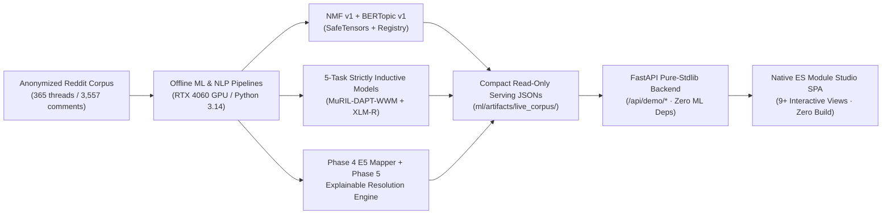

# Deliverable 4 — Reddit Community Intelligence (RCI V6.2) AI Architecture Document

> **Document ID:** `RCI-V6.2-D4` · **Navigation:** [← Deliverable 3 (Prototype)](./DELIVERABLE_3_PROTOTYPE_GUIDE.md) · [Submission Index](./README.md) · [Deliverable 5a (Math) →](./MATHEMATICAL_FOUNDATIONS.md)  
> **Project Title:** AI-Powered Discovery of Student Issues and Solutions from Multilingual Reddit Discussions  
> **System Version:** RCI V6.2 (preserving NMF v1, V5 historical benchmarks, and strictly inductive V6 models)

---

## 1. Problem Definition

Indian Institute of Management (IIM) applicants, current students, and alumni debate admissions, waitlists, placements, tuition ROI, loans, curriculum, hostels, and campus life on public Reddit communities using English, Romanized Hindi (`hi-en` / `hi`), Devanagari, Romanized Odia (`or-en`), Gen-Z slang, and expressive emojis. RCI solves the central research question:

> *"Can an AI system automatically discover the major issues discussed by the IIM community on Reddit and determine whether, and how, the Reddit community provides solutions to those issues?"*

Rather than a sentiment dashboard, RCI implements a traceable **5-stage analytical chain**:
$$\text{ISSUE} \rightarrow \text{DISCUSSION} \rightarrow \text{COMMUNITY RESPONSE} \rightarrow \text{SOLUTION} \rightarrow \text{RESOLUTION EVIDENCE}$$

---

## 2. Data Acquisition

- **Source Archive:** Read-only anonymized snapshot of public IIM/MBA Reddit threads across 8 subreddits (`r/IIMSambalpurUG`, `r/MBAIndia`, `r/IIMCATPreparation`, `r/CATPrep`, `r/iim_CAT`, `r/CATStudyRoom`, `r/CATpreparation`, `r/Indian_Academia`) collected via public Arctic Shift archive snapshots prior to V6 (`365` threads, `3,557` comments). Zero live Reddit or Arctic Shift collection occurs at runtime.
- **Privacy & Anonymization:** All Reddit usernames and PII are removed; IDs are pseudonymized (`post_0001..0365`, `cmt_00001..03557`). Parent-comment hierarchy (`parent_reddit_id`) and UTC timestamps (`created_at`) are preserved intact.
- **Four-Field Provenance Separation:** `collection_authorization`, `research_use_authorization`, `model_training_authorization`, and `public_redistribution_permission` are stored and served as separate metadata fields (never inferred from ingestion).

---

## 3. Data Preprocessing

- **Noise Hygiene:** AutoModerator boilerplate, bot comments, GIF-only embeds, and `[deleted]` stubs are filtered prior to unsupervised topic modeling (`3,557 → 3,459` eligible documents), while `original_text` is never destroyed on any record.
- **Non-Destructive Informal Normalization (`context_normalizer.py` & `indian_reddit_lid.py`):**
  - **Context-Aware Gen-Z Slang Disambiguation:** Distinguishes evaluative Gen-Z `mid` (*"mess food is mid"* → `mediocre`) from literal compounds (*"mid sem"*, *"mid Dec"*), `based` vs. *"based on"*, and `cooked` (*"we are cooked"* → `overwhelmed doomed`) vs. *"freshly cooked food"*. Preserves tone terms (`bhai`, `bro`, `yaar`, `lol`, `lmao`) in metadata.
  - **Affect-Preserving Emoji Semantics (`emoji_normalizer.py`):** Emojis are never deleted by default; curated affect mappings translate `😭`, `💀`, `🤡`, `🔥`, `🙏`, `👍`, `🤣`, etc. into semantic affect phrases (`sadness frustration`, `extreme amusement disbelief`, `sarcasm mockery`) while keeping `original_text` intact.
  - **Romanized Indic Variant Unification (`normalize_romanized_indic`):** Maps spelling variants (`nhi/nahin → nahi`, `bohot/boht → bahut`, `krna → karna`, `valo → bhalo`, `kemti → kemiti`) with exact span-level `transformations` metadata (`197` real comments, `245` tracked edits).

---

## 4. Language Handling

Implemented in pure Python stdlib (`backend/app/services/nlp/indian_reddit_lid.py`):
- **Language vs. Script Separation:** Explicitly decouples Unicode script (`latin`, `devanagari`, `bengali`, `odia`, `mixed`, `unknown`) from language (`en`, `hi`, `bn`, `or`, `hi-en`, `bn-en`, `or-en`, `und`). Romanized Hindi in Latin script is never auto-labelled English; proper-noun guards prevent institution names like *"Bodh Gaya"* from triggering Hindi verb *"gaya"*.
- **Span-Level Identification (`detect_language_spans`):** Splits comments along sentence/line/danda boundaries with character offsets `[start, end)`, preventing multi-language comments (`78` across the corpus) from being forced into one monolingual label.
- **Explicit Uncertainty & Abstention:** Computes calibrated heuristic confidence and abstains (`abstain = True`, `uncertainty_flag = "low_evidence_abstain"`) on numeric scores, emoji-only replies, and ultra-short ambiguous utterances (`95.83%` selective accuracy on non-abstained predictions over `n = 84` real manually reviewed comments; `100.0%` script accuracy).

---

## 5. Topic Discovery (Dual-Method Coexistence: NMF v1 + BERTopic v1)

- **Preserved NMF v1 Baseline (`nmf_topic_discoverer.py` → `topic_discovery.json`):** TF-IDF (word 1–2 grams, `8,000` vocab) + `NMF(n_components=10, init="nndsvda", random_state=42)`. Provides 100% document assignment (`0` outliers) and deterministic stability. Kept untouched as default.
- **Companion BERTopic v1 Pipeline (`ml/topics/bertopic/` → `bertopic_v1_topics.json` + SafeTensors):**
  1. Multilingual dense embeddings via **`intfloat/multilingual-e5-small`** (MIT, `384-dim`, `2.37 ms/doc` GPU, `100%` Top-1 across EN/HI/BN/OR/Hinglish/Banglish/Roman-Odia synthetic probes; selected over `paraphrase-multilingual-MiniLM-L12-v2` and mean-pooled `muril_dapt_wwm`, which collapsed into 2 clusters due to MLM anisotropy).
  2. Deterministic UMAP (`n_neighbors=15, n_components=5, metric="cosine", random_state=42`).
  3. Density-based HDBSCAN (`min_cluster_size=25, min_samples=8, cluster_selection_method="eom"`), discovering **35 natural semantic clusters** without forcing `K=10` and explicitly preserving **1,320 outliers (`38.2%`) in topic `-1`**.
  4. Indic-script-safe `CountVectorizer(token_pattern=r"(?u)[A-Za-z0-9\u0900-\u0d7f]{2,}", min_df=1)` + BM25 `ClassTfidfTransformer(bm25_weighting=True, reduce_frequent_words=True)`.
  5. Tracked in [`ml/artifacts/topic_models/registry.json`](../../ml/artifacts/topic_models/registry.json) with isolated namespaces (`nmf:v1:<id>` vs. `bertopic:bertopic_v1:<id>`).

---

## 6. Issue Classification

- **Task:** 8-label multi-label classification (`academic_workload`, `administrative_communication`, `campus_infrastructure`, `curriculum_teaching`, `extracurriculars`, `financial_concerns`, `hostel_facilities`, `placements`).
- **Architecture:** Strictly inductive 5-fold ensemble of **`muril_dapt_strict_inductive_wwm_8ep`** (`##`-aligned Whole-Word Masking DAPT with `0/44` test-thread overlap) using native `[CLS] reply [SEP] parent_or_title [SEP]` segment pairs (`max_length=256, truncation="only_second"`), **Asymmetric Loss (ASL, $\gamma_-=2, m=0.05$)**, bounded OOF thresholds (`[0.30, 0.70]`), and per-label monotonic OOF Platt calibration.
- **Verified Performance (`n = 92` frozen test):** **`60.83%`** Macro F1 (`3-seed mean 59.85% ± 0.99%`; statistically significant **`+15.00 pp`** over V5 `45.72%`, `p = 0.992`).

---

## 7. Sentiment and Emotion

- **Sentiment (3-class single-label: `negative`, `neutral`, `positive`):** `muril_dapt_strict_inductive_wwm_8ep`, `comment_only` input (preventing OP title affect bleed), class-weighted cross-entropy (`CE-W`), 5-fold logit ensemble (`T = 1.0`). Frozen test: **`65.11%`** Macro F1 (`3-seed 64.33% ± 1.02%`, ECE `0.104`, `−27%` ECE vs. V5).
- **Emotion (6-label multi-label: `confidence`, `curiosity`, `frustration`, `gratitude`, `hope`, `stress`):** `muril_dapt_strict_inductive_wwm_8ep`, `comment_only`, ASL + bounded OOF thresholds + OOF Platt calibration. Frozen test: **`61.04%`** Macro F1 (`3-seed 59.28% ± 1.25%`).

---

## 8. Community Response Classification

- **Locked Canonical 6-Class Taxonomy:** `1. agreement`, `2. personal_experience`, `3. opinion`, `4. advice`, `5. solution`, `6. counterargument`.
- **Architecture:** 5-fold group-aware ensemble (`muril_dapt_strict_inductive_wwm_8ep` strict OOF `53.52%`, 3-seed `54.64% ± 1.1%`; zero-DAPT `xlm-roberta-base` 3-seed `58.22% ± 0.41%`; Track B V2 expanded data `59.86%`, `+6.56 pp`, CI `[+1.99, +12.15]`). `comment_only` input prevents reply-role bleed from parent comments.

---

## 9. Solution Detection

- **Task:** Binary classification (`not_solution` vs. `solution`) identifying concrete actionable remedies separately from general opinions or empathetic advice.
- **Architecture:** Zero-DAPT **`xlm-roberta-base`** 5-fold ensemble, `comment_only`, `CE-W`, fixed `0.50` threshold (selected via nested OOF CV).
- **Verified Performance (`n = 92` frozen test):** **`85.88%`** Macro F1 (`3-seed 85.02% ± 1.21%`; statistically significant **`+10.93 pp`** over V5 `76.10%`, `p = 0.999`, reducing false positives by `42%`).

---

## 10. Issue–Solution Mapping

Implemented in [`ml/linking/contextual_mapper.py`](../../ml/linking/contextual_mapper.py) alongside preserved `TfidfCosineIssueSolutionLinker`:
- Fuses 4 positive signals (`0.38 × E5 multilingual cosine + 0.14 × TF-IDF cosine + 0.18 × thread/parent structural context + 0.30 × upstream detector confidence`) minus an explicit **negation/contradiction/non-actionable penalty** (`p_neg ∈ [0, 0.55]`) rejecting `[Removed]`, bare URLs, DM redirects, sarcasm, and dismissals.
- Groups `951` linked corpus solutions (`verification_status: "model_inferred"`) into `282` semantic solution clusters across all 8 domains via cosine `AgglomerativeClustering`.
- Outperforms the V5 TF-IDF baseline on `n = 64` manually reviewed real pairs: Pairwise F1 **`86.57%`** vs. `80.00%` (`+6.57 pp`), FPR **`13.33%`** vs. `16.67%`, **`P@3 = 100.0%`**, `MRR = 1.00`.

---

## 11. Unresolved Issue Detection

Implemented in [`ml/linking/resolution_engine.py`](../../ml/linking/resolution_engine.py) alongside `EvidenceBasedResolver`:
- Formalizes all 4 distinct states (`reported_success`, `reported_pending`, `proposed_only`, `insufficient_evidence`) and 4 verdict tiers (`Resolved`, `Partially Resolved`, `Unresolved`, `Insufficient Evidence`).
- Evaluates 8 explainable signals including **explicit procedural-failure vs. rhetorical contradiction detection** (`26` threads with contradictory follow-ups), elapsed discussion span, Phase 4 solution relevance, and confidence volume guard.
- Enforces two hard guardrails: (1) `proposed_only` score is capped at `0.58` so proposals never claim `Resolved` without outcome confirmation; (2) discussion volume never boosts `resolution_score`.
- Human-reviewed evaluation (`n = 40` real threads): **`80.0%`** 4-state accuracy, **`82.52%`** Macro F1, **`0.00%` (`0/33`) false resolution claim rate**, **`98.51%`** unresolved detection F1, **`87.5%`** evidence retrieval accuracy.

---

## 12. Hardware Architecture

- **Offline ML Training & Embedding Node:** NVIDIA GeForce RTX 4060 Laptop GPU (`8,188 MiB` VRAM, CUDA `13.2`, PyTorch `2.14.1+cu132`, `bfloat16` AMP), Python `3.14.6`.
- **Measured Throughput:** Single-task MuRIL/XLM-R `1.82 ms/cmt` GPU (`48.9 ms/cmt` CPU); 5-task sequential `9.1 ms/cmt` GPU; shared MTL `1.32 ms/cmt` GPU; `multilingual-e5-small` `2.37 ms/doc` GPU (`8.21s` for all `3,459` corpus comments); TF-IDF + LogReg `<0.15 ms/cmt` CPU.
- **Memory Discipline:** Windows multi-checkpoint sweeps execute via isolated per-experiment subprocesses (`≤ 5` checkpoints/process) to prevent CUDA/allocator exhaustion.

---

## 13. Software Architecture

---

## 14. Training and Evaluation

- **Strict Inductive Split Isolation:** All `44` frozen-test & same-title threads (`749` comments) excluded from WWM DAPT (`0/44` overlap); `trainval_v1 (n = 367)` partitioned via 5-fold `post_id`-grouped CV (custom Group-Preserving Iterative Multi-Label Stratification for `issue` & `emotion`).
- **Strict OOF Governance Audit (Phase 6):** Primary unbiased headlines report strict OOF-only selection (`64.62%` 3-seed mean / `65.01%` V6.0 pure neural / `64.38%` strict Stage 3 vs. V5 `59.48%`); `65.59%` (`v6.1.0`) is explicitly flagged as post-hoc test-inspected rather than unbiased strict selection.
- **Baselines Benchmarked Identically:** Word+Char TF-IDF Logistic Regression (`47.86%`), 2-layer ANN (`48.96%`), 1D TextCNN (`48.35%`), Shared MTL + R-Drop (`56.47%`), Historical V5 (`59.48%`), V6 Strict Inductive (`64.62%` 3-seed).

---

## 15. Deployment

- **Dual Target Design:**
  1. **Local Docker (`docker-compose.yml`):** FastAPI web container + PostgreSQL (`localhost:8000`) serving both static SPA and `/api/demo/*`.
  2. **Vercel Serverless (`vercel.json`, `api/index.py`):** Installs ONLY `fastapi` + `pydantic` (`requirements.txt`), bundling `ml/artifacts/live_corpus/*.json` directly. Verified via zero-ML import audit blocking all scientific libraries (`10/10` endpoints HTTP 200).

---

## 16. Limitations

1. **Corpus Language Skew:** Public IIM subreddits are `81.1%` English and `10.1%` Hinglish/Hindi, with `1` Roman-Odia comment and `0` native Bengali/Odia script comments; Bengali/Odia paths are verified only via separate synthetic probes.
2. **Compact Frozen Test Set (`n = 92`, `37` threads):** Rare classes (`extracurriculars=2`, `stress=5`, `curriculum=5`, `counterargument=9`) exhibit `~16–20 pp` bootstrap 95% CIs; Track B V2 (`n = 162`) awaits final dual-human IAA adjudication.
3. **UMAP/HDBSCAN Seed Sensitivity:** BERTopic `eom` clustering can occasionally collapse on noisy short texts under alternate seeds (`seed=202`), justifying preserving NMF v1 as the deterministic default.
4. **Observation-Window Censoring in Resolution:** Offline resolutions not posted back to Reddit remain `proposed_only`; RCI strictly treats `proposed_only` as unconfirmed rather than guaranteed failure.
5. **ASL Raw Calibration Shift:** Asymmetric Loss requires per-label monotonic OOF Platt calibration (`σ(az+b)`) rather than scalar temperature scaling alone.
