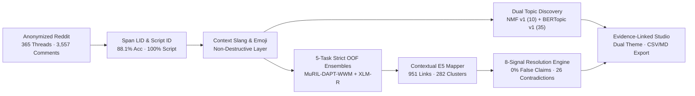

# Reddit Community Intelligence (RCI) — Academic Submission Package (V6.2)

> **Project Title:** AI-Powered Discovery of Student Issues and Solutions from Multilingual Reddit Discussions  
> **Central Research Question:** *"Can an AI system automatically discover the major issues discussed by the IIM community on Reddit and determine whether, and how, the Reddit community provides solutions to those issues?"*  
> **Platform:** Reddit Community Intelligence (RCI) Studio · **Release:** `V6.2` · **Repository:** [github.com/Sohham01/AI_Project](https://github.com/Sohham01/AI_Project) · **Live Studio:** [rci-ten.vercel.app/app](https://rci-ten.vercel.app/app/)

---

## Executive Snapshot

| Evaluation Dimension | Verified V6.2 Benchmark | Governance & Evidence Scope |
| :--- | :--- | :--- |
| **Anonymized Real Corpus** | **365 threads · 3,557 comments** (`8` subreddits) | Pseudonymized IDs (`post_XXXX`, `cmt_XXXXX`); zero usernames, zero raw PII, 4-field separated provenance |
| **5-Task Supervised Models (Strict OOF)** | **`64.62%` 3-seed Macro F1** (`65.01%` V6.0 pure neural) | Frozen real test `n = 92` (`37` threads, `0/44` DAPT overlap); post-hoc `65.59%` V6.1 transparently flagged as diagnostic |
| **Dual Topic Discovery (NMF + BERTopic)** | **`10` NMF factors + `35` BERTopic clusters** (`3,459` docs) | NMF v1 preserved as default; BERTopic v1 (`multilingual-e5-small`) **35/35 human-reviewed (`4.51 / 5.0` coherence)**, `1,320` explicit `-1` outliers |
| **Multilingual Span LID & Romanization** | **`88.10%` acc · `95.83%` selective · `100%` script** | Human-reviewed real benchmark (`n = 84`); `95.52%` code-mix F1, `90.91%` multi-span F1; synthetic probes (`n = 24`) isolated |
| **Contextual Issue–Solution Mapping** | **`86.57%` Pairwise F1 · `100%` P@3 · `13.33%` FPR** | `+6.57 pp` over TF-IDF baseline on human-graded pairs (`n = 64`); **`951` links across `282` semantic clusters** |
| **Explainable Unresolved-Issue Engine** | **`0.00%` false resolution claims (`0/33`) · `98.51%` Unres. F1** | Human-audited `n = 40` threads (`82.52%` 4-state Macro F1); surfaces **`26` contradictory follow-up threads** |
| **Production Engineering & QA** | **`2,204 / 2,204` offline tests · `16 / 16` Vercel checks** | Dual Dusk Dark & Daylight Bone Light SaaS Studio, `11.8×` GZip+compact payload reduction (`90.6 KB`), CSV/Markdown export |

---

## End-to-End Research Workflow



---

## Consolidated Deliverables Index (Deliverables 1–6)

| # | Deliverable | Document | Status | Scope & Key Contents |
| :---: | :--- | :--- | :---: | :--- |
| **D1** | **Real-Life Scenario Video Package** | [`DELIVERABLE_1_VIDEO_PACKAGE.md`](./DELIVERABLE_1_VIDEO_PACKAGE.md) | Script & Storyboard Ready | Complete 3m 15s voiceover script, 6-scene storyboard, and live Studio shot list *(MP4 capture pending — explicitly disclosed)*. |
| **D2** | **Reddit Dataset & Provenance Package** | [`DELIVERABLE_2_DATASET_PACKAGE.md`](./DELIVERABLE_2_DATASET_PACKAGE.md) | Complete | Full post/comment schemas, data dictionary, 4-field provenance authorizations, language distribution, canonical taxonomies, and all 7 tracked evaluation datasets. |
| **D3** | **AI / NLP Prototype Guide** | [`DELIVERABLE_3_PROTOTYPE_GUIDE.md`](./DELIVERABLE_3_PROTOTYPE_GUIDE.md) | Complete | Docker, local Python & slim Vercel deployment guides, 13-endpoint API reference, human-reviewed BERTopic I/O samples, 10 Studio views, and QA commands. |
| **D4** | **AI System Architecture** | [`AI_ARCHITECTURE.md`](./AI_ARCHITECTURE.md) | Complete (16 Sections) | End-to-end architecture across all 16 layers: ingestion, anonymization, multilingual NLP, dual topic modeling, 5-task transformers, linking, resolution, API & security. |
| **D5a** | **Mathematical Foundations** | [`MATHEMATICAL_FOUNDATIONS.md`](./MATHEMATICAL_FOUNDATIONS.md) | Complete | Exact mathematical formulations mapped directly to repository modules (TF-IDF, NMF, E5, UMAP/HDBSCAN, c-TF-IDF, Attention, ASL/CE, Platt calibration, linking, resolution). |
| **D5b** | **System Pseudocode** | [`SYSTEM_PSEUDOCODE.md`](./SYSTEM_PSEUDOCODE.md) | Complete | Reproducible end-to-end pipeline pseudocode matching exact implemented classes, thresholds, and artifact schemas. |
| **D6** | **Final Community Insight Report** | [`FINAL_INSIGHT_REPORT.md`](./FINAL_INSIGHT_REPORT.md) | Complete (Q1–Q9) | Evidence-backed answers to all 9 research questions with strict separation of model-inferred corpus observations vs. human-reviewed benchmarks. |

> **Interactive Walkthrough Notebook:** [`notebooks/RCI_V6_Prototype_Walkthrough.ipynb`](../../notebooks/RCI_V6_Prototype_Walkthrough.ipynb)

---

## Supporting V6 Technical & Experimental Reports

| Track | Report | Key Focus |
| :--- | :--- | :--- |
| **Audit & Governance** | [`V6_PRE_IMPLEMENTATION_AUDIT.md`](../V6_PRE_IMPLEMENTATION_AUDIT.md) | Requirement-by-requirement audit against the original academic problem statement |
| **Topic Discovery** | [`BERTOPIC_IMPLEMENTATION_AND_COMPARISON.md`](../BERTOPIC_IMPLEMENTATION_AND_COMPARISON.md) | Fair 3,459-doc comparison of NMF v1 vs. 5 BERTopic configs + 35-cluster human review (`4.51/5.0`) |
| **Multilingual NLP** | [`MULTILINGUAL_PROCESSING_EVALUATION.md`](../MULTILINGUAL_PROCESSING_EVALUATION.md) | Span-level LID, script separation, Romanized normalization & abstention benchmarks (`n = 84` real / `n = 24` synthetic) |
| **Informal Text Ablation** | [`SLANG_EMOJI_ABLATION.md`](../SLANG_EMOJI_ABLATION.md) | 5-task context-aware Gen-Z slang (`mid`/`based`/`cooked`) & affect-emoji ablation (`20` TF-IDF + `100` GPU folds) |
| **Issue–Solution Mapping** | [`ISSUE_SOLUTION_MAPPING_REPORT.md`](../ISSUE_SOLUTION_MAPPING_REPORT.md) | Multilingual E5 contextual mapper + negation penalty + agglomerative clustering (`86.57%` F1) |
| **Unresolved Detection** | [`UNRESOLVED_ISSUE_METHODOLOGY.md`](../UNRESOLVED_ISSUE_METHODOLOGY.md) | 8-signal explainable resolution engine, contradictory follow-up taxonomy & `0.00%` false-claim audit |
| **Model Optimization** | [`V5_MODEL_IMPROVEMENT_REPORT.md`](../V5_MODEL_IMPROVEMENT_REPORT.md) | Strict inductive DAPT (`88.32 → 25.23` PPL), 4-architecture benchmarks & Section L Strict OOF Governance Audit |
| **Cross-Model Synthesis** | [`CROSS_MODEL_INSIGHT_ENGINE.md`](../CROSS_MODEL_INSIGHT_ENGINE.md) | Evidence-linked observation/interpretation separation, topic/post citations & limitations |
| **Release Verification** | [`V6_QA_AND_READINESS_REPORT.md`](../V6_QA_AND_READINESS_REPORT.md) | End-to-end automated QA, Vercel zero-ML audit, Docker health & browser verification log |

---

## Quick Verification Commands

```bash
# 1. Start the full local SaaS Studio via Docker Compose (http://localhost:8000/app)
docker compose up -d --build web

# 2. Run the complete offline automated test suite (2,204 tests)
pytest -q --ignore=ml/experiments --ignore=backend/test_migrations_postgres.py
```
